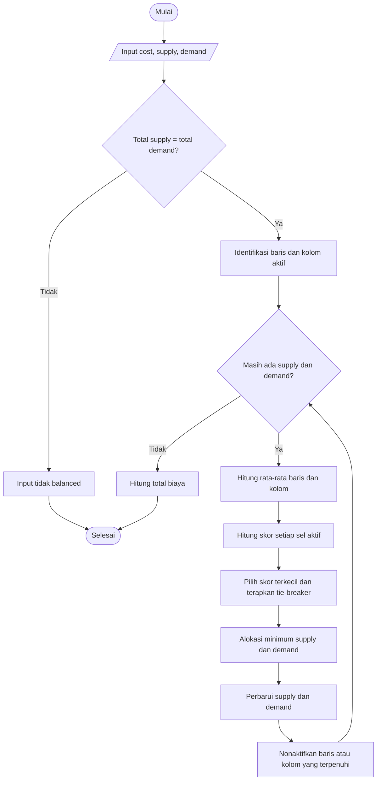

# Average Least Cost Method (AVG-LCM)

**Modifikasi Least Cost Method untuk Penyelesaian Transportation Problem**

Kelompok 10 — Operations Research

## 1. Deskripsi Proyek

Transportation Problem (TP) merupakan permasalahan optimasi yang bertujuan menentukan distribusi barang dari sejumlah sumber (*supply*) menuju sejumlah tujuan (*demand*) dengan total biaya transportasi seminimal mungkin.

Salah satu metode untuk menyelesaikan permasalahan ini adalah **Least Cost Method (LCM)**, yang memilih sel dengan biaya transportasi terkecil pada setiap iterasi.

Namun, LCM hanya mempertimbangkan biaya individual tanpa memperhatikan karakteristik biaya pada baris dan kolom lainnya.

Oleh karena itu, proyek ini mengusulkan **Average Least Cost Method (AVG-LCM)**, yaitu modifikasi LCM yang mempertimbangkan rata-rata biaya baris dan kolom untuk menentukan prioritas alokasi.

Tujuan modifikasi ini adalah meningkatkan kualitas solusi awal Transportation Problem dengan tetap mempertahankan proses alokasi yang sederhana.

## 2. Metode AVG-LCM

### 2.1 Perbedaan LCM dan AVG-LCM

| Aspek | LCM | AVG-LCM |
|---|---|---|
| Pemilihan sel | Biaya terkecil | Skor terkecil |
| Pertimbangan biaya | Biaya individual | Biaya individual dan rata-rata baris/kolom |
| Perhitungan rata-rata | Tidak | Ya |
| Alokasi | Minimum supply dan demand | Minimum supply dan demand |
| Pembaruan | Menonaktifkan baris/kolom terpenuhi | Sama, kemudian menghitung ulang rata-rata |

### 2.2 Rumus AVG-LCM

Skor setiap sel dihitung menggunakan:

\[
Score_{ij}=C_{ij}-\alpha\left(\frac{\bar C_i+\bar C_j}{2}\right)
\]

Keterangan:

- \(C_{ij}\): biaya transportasi dari sumber \(i\) ke tujuan \(j\).
- \(\bar C_i\): rata-rata biaya pada baris \(i\) yang masih aktif.
- \(\bar C_j\): rata-rata biaya pada kolom \(j\) yang masih aktif.
- \(\alpha\): parameter yang mengatur pengaruh rata-rata biaya.

Pada implementasi ini, nilai **α = 2** digunakan sebagai konfigurasi utama berdasarkan hasil benchmark.

Ketika α = 0, skor kembali sama dengan biaya asli sehingga pemilihan sel mengikuti LCM.

### 2.3 Aturan Tie-Breaker

Jika terdapat beberapa sel dengan skor yang sama, pemilihan dilakukan berdasarkan prioritas berikut:

1. Skor terkecil.
2. Biaya transportasi asli terkecil.
3. Kapasitas alokasi terbesar.
4. Indeks baris terkecil.
5. Indeks kolom terkecil.

## 3. Langkah-Langkah Algoritma

AVG-LCM bekerja secara iteratif dengan langkah berikut:

1. Membaca matriks biaya, supply, dan demand.
2. Memastikan total supply sama dengan total demand.
3. Mengidentifikasi baris dan kolom yang masih aktif.
4. Menghitung rata-rata biaya setiap baris aktif.
5. Menghitung rata-rata biaya setiap kolom aktif.
6. Menghitung skor setiap sel aktif menggunakan rumus AVG-LCM.
7. Memilih sel dengan skor terkecil berdasarkan aturan tie-breaker.
8. Mengalokasikan barang sebanyak minimum antara supply dan demand.
9. Memperbarui supply dan demand.
10. Menonaktifkan baris atau kolom yang telah terpenuhi.
11. Mengulangi perhitungan hingga seluruh supply dan demand terpenuhi.
12. Menghitung total biaya transportasi menggunakan biaya asli.

### 3.1 Flowchart



## 4. Contoh Perbandingan LCM vs AVG-LCM

Berikut contoh Transportation Problem ketika LCM menghasilkan biaya lebih tinggi dibandingkan AVG-LCM.

### 4.1 Data Transportation Problem

| Sumber | D1 | D2 | D3 | Supply |
|---|---:|---:|---:|---:|
| S1 | 15 | 7 | 25 | 12 |
| S2 | 8 | 12 | 14 | 17 |
| S3 | 17 | 19 | 21 | 7 |
| **Demand** | **12** | **10** | **14** | |

Total supply = 36 dan total demand = 36, sehingga masalah ini balanced.

### 4.2 Penyelesaian Menggunakan LCM

LCM memilih sel berdasarkan biaya terkecil yang masih tersedia.

| Iterasi | Sel | Biaya/unit | Alokasi | Biaya |
|---|---|---:|---:|---:|
| 1 | S1 → D2 | 7 | 10 | 70 |
| 2 | S2 → D1 | 8 | 12 | 96 |
| 3 | S2 → D3 | 14 | 5 | 70 |
| 4 | S3 → D3 | 21 | 7 | 147 |
| 5 | S1 → D3 | 25 | 2 | 50 |
| | | | **Total** | **433** |

Total biaya LCM:

\[
Z_{LCM}=433
\]

### 4.3 Penyelesaian Menggunakan AVG-LCM (α = 2)

Pada AVG-LCM, pemilihan sel mempertimbangkan skor yang diperoleh dari biaya asli serta rata-rata baris dan kolom aktif.

Sebagai contoh, pada iterasi pertama:

Rata-rata baris S1:

\[
\bar C_{S1}=(15+7+25)/3=15,67
\]

Rata-rata kolom D2:

\[
\bar C_{D2}=(7+12+19)/3=12,67
\]

Skor S1 → D2:

\[
Score_{S1,D2}=7-2((15,67+12,67)/2)
\]

\[
Score_{S1,D2}\approx-21,33
\]

Setelah seluruh skor dibandingkan, sel S1 → D2 dipilih dan dialokasikan sebanyak 10 unit.

Proses yang sama dilakukan pada iterasi berikutnya.

| Iterasi | Sel | Biaya/unit | Alokasi | Biaya |
|---|---|---:|---:|---:|
| 1 | S1 → D2 | 7 | 10 | 70 |
| 2 | S1 → D1 | 15 | 2 | 30 |
| 3 | S2 → D1 | 8 | 10 | 80 |
| 4 | S2 → D3 | 14 | 7 | 98 |
| 5 | S3 → D3 | 21 | 7 | 147 |
| | | | **Total** | **425** |

Total biaya AVG-LCM:

\[
Z_{AVG-LCM}=425
\]

### 4.4 Perbandingan Hasil

| Metode | Total Biaya | Selisih terhadap optimal | Status |
|---|---:|---:|---|
| LCM | 433 | 1,88% | Tidak optimal |
| AVG-LCM (α = 2) | 425 | 0% | Optimal |

Pada contoh ini, biaya optimal adalah 425.

AVG-LCM menghasilkan biaya lebih rendah sebesar 8 satuan biaya dibandingkan LCM, atau penghematan sekitar **1,85% terhadap biaya LCM**.

Hal ini menunjukkan bahwa pemilihan biaya terkecil secara langsung tidak selalu menghasilkan solusi terbaik. Dengan mempertimbangkan rata-rata baris dan kolom, AVG-LCM dapat memilih urutan alokasi yang lebih menguntungkan.

Namun, AVG-LCM tetap merupakan metode heuristik dan tidak menjamin solusi optimal pada seluruh kasus.

## 5. Benchmark dengan Algoritma Lain

Benchmark dilakukan menggunakan **69 testcase Transportation Problem** dengan membandingkan tujuh metode:

- Least Cost Method (LCM)
- Vogel's Approximation Method (VAM)
- Average Least Cost Method (AVG-LCM)
- CSM
- RBSM
- SAM
- SSM

### 5.1 Indikator Evaluasi

**Optimal:** jumlah testcase yang menghasilkan biaya sama dengan solusi optimal referensi.

**Optimality Gap:** persentase selisih biaya metode terhadap biaya optimal. Semakin kecil, semakin baik.

**Runtime:** rata-rata waktu eksekusi algoritma dalam milidetik.

**Iterations:** rata-rata jumlah iterasi yang dibutuhkan algoritma.

### 5.2 Hasil Benchmark (α = 2)

| Metode | Optimal / 69 | Optimal (%) | Avg Gap (%) | Avg Iter | Avg Time (ms) |
|---|---:|---:|---:|---:|---:|
| LCM | 14 | 20,29 | 6,7958 | 14,49 | 0,35386 |
| VAM | 36 | 52,17 | 3,6093 | 14,49 | 1,23644 |
| **AVG-LCM** | **55** | **79,71** | **0,7765** | **14,49** | **0,59425** |
| CSM | 44 | 63,77 | 2,4851 | 5,10 | 0,29014 |
| RBSM | 44 | 63,77 | 2,4851 | 5,10 | 0,29181 |
| SAM | 45 | 65,22 | 2,1895 | 5,06 | 0,29813 |
| SSM | 42 | 60,87 | 2,8085 | 5,19 | 0,27629 |

Seluruh 69 testcase berhasil diproses pada pengujian yang ditampilkan.

### 5.3 Perbandingan Parameter Alpha

| Alpha | Solusi Optimal | Optimal (%) | Avg Gap (%) |
|---|---:|---:|---:|
| 1,0 | 24/69 | 34,78 | 3,3973 |
| 1,5 | 39/69 | 56,52 | 1,7368 |
| **2,0** | **55/69** | **79,71** | **0,7765** |
| 2,5 | 43/69 | 62,32 | 1,2833 |

Hasil menunjukkan bahwa peningkatan alpha dari 1 hingga 2 meningkatkan kualitas solusi AVG-LCM. Namun, ketika alpha dinaikkan menjadi 2,5, jumlah solusi optimal kembali menurun.

Dengan demikian, alpha = 2 merupakan konfigurasi terbaik pada dataset pengujian ini.

### 5.4 Dokumentasi Hasil Benchmark

Tambahkan gambar hasil benchmark pada folder `images/`.

```text
images/
├── benchmark_alpha_1.png
├── benchmark_alpha_1_5.png
├── benchmark_alpha_2.png
└── benchmark_alpha_2_5.png
```

Setelah gambar ditambahkan, aktifkan referensi Markdown berikut dengan menghapus tanda komentar:

```markdown
<!--


-->
```

## 6. Kesimpulan

Berdasarkan pengujian terhadap 69 testcase Transportation Problem, AVG-LCM dengan alpha = 2 menunjukkan performa terbaik dari segi jumlah solusi optimal dan rata-rata optimality gap dibandingkan LCM, VAM, CSM, RBSM, SAM, dan SSM. Metode ini menghasilkan **55 solusi optimal (79,71%)**, dengan average gap sebesar **0,7765%** dan runtime sekitar **0,59 ms**. Hasil tersebut menunjukkan bahwa penggunaan rata-rata biaya baris dan kolom dapat meningkatkan kualitas solusi dibandingkan LCM konvensional. Meskipun AVG-LCM membutuhkan waktu komputasi lebih tinggi dibandingkan beberapa metode lain, hasil pengujian menunjukkan keseimbangan yang baik antara kualitas solusi dan runtime. Temuan ini berlaku pada dataset yang diuji dan tidak menjamin bahwa AVG-LCM selalu menghasilkan solusi optimal untuk seluruh Transportation Problem.
